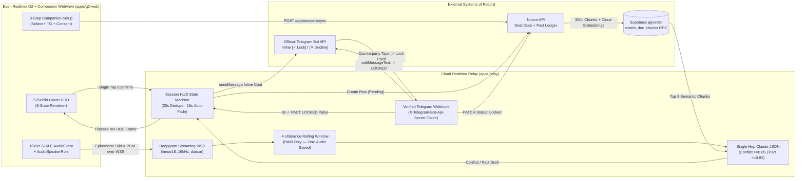

# PACT — Live Bilateral Commitment & Fact-Check HUD (Even Realities G2)

**PACT** is a foreground-session heads-up agreement and fact-check console built for **Even Realities G2** smart glasses (`@evenrealities/even_hub_sdk@0.0.16`). During high-stakes founder, client, partnership, and OTC conversations, PACT keeps the `576×288` green waveguide calm and dark by default—intervening **only** when a spoken claim contradicts your synced **Notion** deal documents, or when a concrete verbal promise is ready to be locked bilaterally across **Notion** and **Telegram** with a single tap on the temple.

---

## 1. The Problem

High-stakes negotiations fail in two predictable ways:
1. **Live Factual Drift:** Counterparties misquote caps, percentages, fees, or delivery quarters mid-sentence (*"Since we agreed on a 15% revenue share cap…"* when the signed SOW says `10%`), and pulling out a laptop or phone breaks eye contact and leverage.
2. **Handshake Drift:** Verbal commitments (*"I'll send the revised cap table PDF by Friday 5pm"*) evaporate between the meeting room and follow-up threads because nobody locks owner + deliverable + deadline while both parties are still aligned.

Conventional AR overlays try to stream full live transcripts onto the lens—causing severe **reading-while-speaking cognitive stutter**.

---

## 2. Why Even Realities G2

- **Blank-by-Default Dark HUD (`576×288` Waveguide):** PACT renders a dim single-line heartbeat (`PACT · ACTIVE`, `textColor: 1`) with lines 2–3 completely blank during normal conversation. Every active frame strictly obeys a unit-tested **3 lines × ≤28 characters** budget (`formatHudFrame()`) updated flicker-free in place via `TextContainerUpgrade`.
- **Hardware-Assisted Speaker Attribution (`AudioSpeakerRole`):** PACT ingests G2's `event.audioEvent.speakerRole` (`self` vs `other`) alongside Deepgram word-level diarization so first-person promises spoken by the wearer automatically assign `Owner: Me`, while counterparty promises assign `Owner: Counterparty`.
- **Eyes-Up Tactile Control:**
  - **Single Tap (`CLICK_EVENT` / normalized `undefined`):** Confirms a `PACT_DRAFT` card and dispatches it to Notion + Telegram.
  - **Double Tap (`DOUBLE_CLICK_EVENT`):** Immediately dismisses any `CONFLICT` or `PACT_DRAFT` back to `DARK_IDLE`.
  - **15-Second Auto-Fade & 20-Second Semantic Cooldown:** Unactioned alerts fade cleanly to `DARK_IDLE` after 15 seconds, and semantic deduplication prevents repeat alerts.

---

## 3. Read & Write Architecture



### Exact 5 HUD States (`3 lines × ≤28 chars`)

| State | Line 1 | Line 2 | Line 3 | Behavior |
| :--- | :--- | :--- | :--- | :--- |
| `DARK_IDLE` | `PACT · ACTIVE` | *(blank)* | *(blank)* | Dim (`textColor: 1`), zero clutter |
| `CONFLICT` | `! CONFLICT · SOW` | `Doc: 10% rev-share` | `Said: 15% rev-share` | `confidence >= 0.85`, 15s auto-fade |
| `PACT_DRAFT` | `PACT? [TAP: LOCK]` | `Send revised cap table PDF` | `Me · Fri 5pm` | Single-tap to send, double-tap dismiss |
| `SENT_PENDING` | `SENT TO TG + NOTION` | `Awaiting TG tap...` | `Send revised cap table PDF` | Notion `Pending` + Telegram card live |
| `LOCKED_PULSE` | `✓ PACT LOCKED` | `Send revised cap table PDF` | `By @alex_vc · Saved` | Auto-returns to `DARK_IDLE` after 3s |

---

## 4. Safety, Security & Privacy Guarantees

- **Zero Client Secrets:** `apps/g2-web` contains zero API keys (`DEEPGRAM_API_KEY`, `ANTHROPIC_API_KEY` / `OPENROUTER_API_KEY`, `NOTION_API_KEY`, `TELEGRAM_BOT_TOKEN`, and `SUPABASE_SERVICE_ROLE_KEY` live exclusively on `apps/relay`).
- **Zero Raw Audio Persistence:** 16 kHz signed 16-bit PCM frames (`3,200` bytes / 100 ms) are streamed ephemerally in memory to Deepgram and discarded immediately. No audio column or bucket exists anywhere in `supabase/schema.sql`.
- **Explicit Participant Consent Gate:** The companion `Start Session` control remains locked until the explicit ephemeral-audio consent checkbox is checked.
- **Zero Autonomous Writes:** Neither Claude nor the relay can write to Notion or message a Telegram group autonomously. Every write requires a physical single-tap confirmation on the G2 HUD while `PACT_DRAFT` is displayed.
- **Cryptographic Webhook Verification:** `POST /webhooks/telegram` validates `X-Telegram-Bot-Api-Secret-Token` before processing any `[✓ Lock Pact]` or `[✕ Decline]` callback.

---

## 5. Hackathon Track Alignment (Heads Up 2026)

- **Primary Track — Track 04 (AI Assistants & Work):**
  - **Claude** single-hop strict JSON extraction for real-time factual contradiction detection (`confidence >= 0.85`) and structured commitment drafting (`confidence >= 0.82`).
  - **Notion** bidirectional workflow: pre-session deal document block indexing into `pgvector` (**READ**) + live **Notion Pact Ledger** database creation (`Pending`) and bilateral confirmation patching (`Locked` + `@username` + timestamp) (**WRITE**).
- **Secondary Track — Track 01 (Messaging & News) & Best Telegram Integration:**
  - **Official Telegram Bot API** interactive bilateral handshake cards (`[✓ Lock Pact]` / `[✕ Decline]`), instant `answerCallbackQuery` acknowledgement, tamper-evident `editMessageText` status updates (`✓ LOCKED by @username`), and sub-second WebSocket push back onto the G2 waveguide (`✓ PACT LOCKED`).

---

## 6. Quickstart & Commands

### Prerequisites
- Node.js `20.17+` / `22.13+` / `24+` (lightweight TypeScript workspaces — zero Docker, zero local ML models, runs smoothly in 4 GB RAM).
- `@evenrealities/evenhub-simulator` for desktop G2 waveguide + input simulation.

### 1. Install & Configure
```bash
npm install
cp apps/relay/.env.example apps/relay/.env
cp apps/g2-web/.env.example apps/g2-web/.env
```
Run [`supabase/schema.sql`](./supabase/schema.sql) in your Supabase SQL Editor to enable `pgvector` and create `sessions`, `doc_chunks`, `pacts`, `conflicts`, and `match_doc_chunks`.

**Notion Pact Ledger Properties** (Database shared with your Notion integration):
- `Title` (`title`), `Owner` (`rich_text`), `Due` (`rich_text`), `Status` (`select`: `Pending`, `Locked`, `Declined`), `Source Quote` (`rich_text`), `Session ID` (`rich_text`), `Confirmed By` (`rich_text`).

### 2. Run Locally with `evenhub-simulator`
```bash
# Terminal 1 — Start Realtime Relay (HTTP + WS on :8787)
npm run dev:relay

# Terminal 2 — Start G2 WebView Companion App (:5173)
npm run dev:web

# Terminal 3 — Launch EvenHub G2 Simulator (with optional laptop mic --aid or automation port)
evenhub-simulator --list-audio-input-devices
evenhub-simulator http://localhost:5173 --aid "<DEVICE_ID>"
# Or with HTTP automation server:
evenhub-simulator http://localhost:5173 --automation-port 9898
```

### 3. Typecheck, Test & Build `.ehpk` Package
```bash
npm run typecheck
npm test
npm run pack:ehpk
# Outputs verified EvenHub package: apps/g2-web/pact.ehpk
```

### 4. Production Deployment
- **Relay (`apps/relay`):** Deploy via [`render.yaml`](./render.yaml) on Render or [`apps/relay/fly.toml`](./apps/relay/fly.toml) on Fly.io, then register your Telegram webhook:
  ```bash
  curl -X POST "https://api.telegram.org/bot<TELEGRAM_BOT_TOKEN>/setWebhook" \
    -H "Content-Type: application/json" \
    -d '{"url":"https://<YOUR_RELAY_DOMAIN>/webhooks/telegram","secret_token":"<TELEGRAM_WEBHOOK_SECRET>"}'
  ```
- **Companion WebView (`apps/g2-web`):** Deploy via [`apps/g2-web/vercel.json`](./apps/g2-web/vercel.json) on Vercel (`VITE_RELAY_WS_URL=wss://<YOUR_RELAY_DOMAIN>/ws`, `VITE_RELAY_HTTP_URL=https://<YOUR_RELAY_DOMAIN>`) and pack `pact.ehpk` with `npm run pack:ehpk`.
